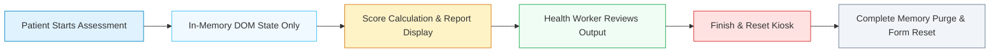

# Primary Health Care (PHC) Mental Health Triage Kiosk

[-0078D7.svg?style=flat-square&logo=apple)](https://www.apple.com/macos/)
[](https://www.ncbi.nlm.nih.gov/pmc/articles/PMC1495268/)
[-0284c7.svg?style=flat-square)](https://www.hhs.gov/hipaa/for-professionals/security/laws-regulations/index.html)
[](https://www.electronjs.org/)
[](#problem-statement--clinical-context)

An offline, touch-optimized desktop kiosk application engineered for **Primary Health Care (PHC)** centers to rapidly, accurately, and confidentially screen incoming patients for depression and psychological vulnerability using the validated **PHQ-9 (Patient Health Questionnaire-9)** clinical instrument.

---

## Table of Contents

- [Problem Statement & Clinical Context](#problem-statement--clinical-context)
- [Key Features](#key-features)
- [Clinical Scoring & Triage Stratification](#clinical-scoring--triage-stratification)
  - [PHQ-9 Scoring Matrix](#phq-9-scoring-matrix)
  - [Critical Item 9: Suicide Risk Protocol](#critical-item-9-suicide-risk-protocol)
- [Strictly Stateless Architecture (HIPAA / Zero-PHI)](#strictly-stateless-architecture-hipaa--zero-phi)
- [User Interface & Kiosk Workflow](#user-interface--kiosk-workflow)
  - [Screen 1: Welcome & Privacy Guarantee](#screen-1-welcome--privacy-guarantee)
  - [Screen 2: Clinical PHQ-9 Assessment](#screen-2-clinical-phq-9-assessment)
  - [Screen 3: Triage Diagnostic Summary](#screen-3-triage-diagnostic-summary)
- [Repository File Structure](#repository-file-structure)
- [Technical Specifications & Tech Stack](#technical-specifications--tech-stack)
- [Installation & Getting Started](#installation--getting-started)
  - [Prerequisites](#prerequisites)
  - [Installation](#installation)
  - [Running the Kiosk](#running-the-kiosk)
- [Packaging for macOS (.dmg)](#packaging-for-macos-dmg)
- [Physical Kiosk Deployment Guidelines](#physical-kiosk-deployment-guidelines)
- [Clinical Disclaimer & Emergency Helplines](#clinical-disclaimer--emergency-helplines)

---

## Problem Statement & Clinical Context

- **Problem Statement ID:** 253
- **Domain:** HealthTech / Public Health & Mental Health Informatics
- **Target Deployment:** Outpatient intake kiosks at Primary Health Care (PHC) facilities, rural health clinics, and campus wellness centers.

Primary Health Care centers often experience severe patient intake surges with limited psychiatric or counseling staff on duty. Frontline community health workers need an immediate, automated method to identify patients experiencing mild vulnerability or severe depressive crisis without burdening nursing personnel with manual paper-and-pencil scoring.

This system provides a reliable, self-administered intake kiosk running locally on offline hardware, immediately outputting actionable medical recommendations to guide the health worker's next clinical steps.

---

## Key Features

- **Validated Clinical Tool (PHQ-9):** Incorporates all 9 standardized diagnostic criteria assessing the frequency of depressive symptoms over the preceding 2 weeks.
- **Strictly Stateless Architecture:** No database, no local disk logging, no browser cookies, and no network transmission. Complete patient privacy and HIPAA compliance are enforced at the hardware/process boundary.
- **Immediate Triage Stratification:** Automatically calculates composite scores ($0\text{--}27$) and color-codes risk into **Green**, **Yellow**, and **Red** tiers with tailored action directives for healthcare workers.
- **Question 9 Suicide Risk Protocol:** Immediately flags any non-zero endorsement of self-harm or suicidal ideation (Item 9) with an emergency alert banner, regardless of the overall score.
- **Optimized Clinical UI/UX:** Styled with soothing clinical blues, cool grays, clear high-contrast typography, and large touch targets designed specifically for a **900 × 700** desktop kiosk resolution.
- **One-Click Session Purge:** "Finish & Reset Kiosk" wipes all memory variables, radio states, validation states, and resets the interface for the next patient.

---

## Clinical Scoring & Triage Stratification

The assessment uses a 4-point Likert scale across each of the 9 items:
- **Not at all:** `0` points
- **Several days:** `1` point
- **More than half the days:** `2` points
- **Nearly every day:** `3` points

### PHQ-9 Scoring Matrix

| Tier | Score Range | Clinical Category | Health Worker Action Directive |
| :--- | :---: | :--- | :--- |
| **GREEN** | **0 – 4** | Minimal / No Depression | **Status: GREEN.** No specific medical intervention required. Provide standard wellness literature. |
| **YELLOW** | **5 – 14** | Mild to Moderate Vulnerability | **Status: YELLOW.** Schedule a follow-up consultation and recommend local campus/community counseling services. |
| **RED** | **15 – 27** | Moderately Severe to Severe Risk | **Status: RED.** Immediate intervention required. Facilitate contact with local psychiatric support. National Emergency Support: Kiran Mental Health Helpline (1800-599-0019). |

### Critical Item 9: Suicide Risk Protocol

Question 9 asks: *"Thoughts that you would be better off dead, or of hurting yourself in some way"*.

In clinical psychiatric triage, any score $>0$ (Several days, More than half the days, or Nearly every day) represents active suicide or self-harm vulnerability. Even if a patient scores a total of 3 or 4 points, an endorsement on Question 9 triggers a prominent **Critical Safety Flag** instructing the health worker:
> 🚨 **Immediate Clinical Alert — Question 9 Endorsement:** The patient indicated thoughts of self-harm or suicide. Immediate in-person clinical assessment and suicide risk evaluation are required prior to patient discharge, irrespective of the composite score.

---

## Strictly Stateless Architecture (HIPAA / Zero-PHI)

To guarantee 100% compliance with international health information privacy frameworks (including HIPAA and local digital health privacy statutes):



- **Zero Disk Writes:** No JSON logs, CSVs, SQLite databases, or local files are written to disk.
- **Zero Browser Storage:** `localStorage`, `sessionStorage`, and `indexedDB` are explicitly unused.
- **Zero Network Egress:** The application functions fully offline without external telemetry or APIs.
- **Hard Memory Reset:** Triggering `restartKiosk()` unchecks all radio inputs, wipes cached values, resets progress counters, and resets screen containers.

---

## User Interface & Kiosk Workflow

The application operates as a Single Page Application (SPA) divided into 3 discrete screens:

### Screen 1: Welcome & Privacy Guarantee
- Displays the institutional banner: **Primary Health Care (PHC) Mental Health Triage Kiosk**.
- Clarifies the test scope (2–3 minutes, 9 questions, PHQ-9 validated standard).
- Features a prominent **Patient Privacy & Data Security Guarantee** card reassuring patients that no records are retained.
- Initiates assessment with the **Begin Assessment** action button.

### Screen 2: Clinical PHQ-9 Assessment
- Displays the standard clinical prompt: *"Over the last 2 weeks, how often have you been bothered by any of the following problems?"*
- Real-time progress indicator (`X of 9 Completed`) with dynamic progress bar.
- Touch-friendly 4-column radio option cards with hover and selected visual states.
- Client-side validation: If the user attempts to click **Generate Report** with missing answers, an error banner displays the exact missing questions (e.g., `Unanswered: Q3, Q7`) and smoothly scrolls to the first unanswered item.

### Screen 3: Triage Diagnostic Summary
- **Large Circular Score Badge:** 130px circular visual indicator displaying the final composite score (`X / 27`).
- **Color-Coded Alert Banner:** The score ring, alert pills, and action cards dynamically adopt the tier color:
  - Green (`#16a34a`) for scores 0–4
  - Yellow/Amber (`#d97706`) for scores 5–14
  - Red (`#dc2626`) for scores 15–27
- **Health Worker Directive:** Formatted clinical guidance and local/national escalation numbers.
- **Reference Matrix:** Quick-reference baseline for score boundaries.
- **Finish & Reset Kiosk Button:** Purges all session data and safely navigates back to Screen 1.

---

## Repository File Structure

```text
mental-health-kiosk/
├── package.json        # Node.js project manifest & electron-builder DMG configuration
├── main.js             # Electron main process (900x700 kiosk window setup & lifecycle)
├── index.html          # Semantic SPA markup containing the 3 kiosk view screens
├── styles.css          # Clinical CSS design system (calm blues, grays, and status alerts)
├── renderer.js         # PHQ-9 question bank, DOM event handlers, validation, & scoring logic
└── README.md           # Comprehensive clinical & technical documentation
```

---

## Technical Specifications & Tech Stack

| Component | Technology | Detail |
| :--- | :--- | :--- |
| **Shell Framework** | Electron.js (`^29.0.0`) | Cross-platform desktop runtime for web technologies |
| **Packaging Engine** | electron-builder (`^24.13.3`) | Compiles standalone macOS DMG package |
| **Markup** | HTML5 | Accessible, semantic clinical structure |
| **Styling** | CSS3 (Modern Flexbox / Grid) | Custom clinical design tokens, animations, and high-contrast accessibility |
| **Client Logic** | Vanilla JavaScript (ES6+) | Stateless scoring algorithms and DOM manipulation |
| **Default Viewport** | 900 × 700 px | Fixed kiosk resolution with responsive inner scrolling |

---

## Installation & Getting Started

### Prerequisites

- **Node.js:** v18.0.0 or higher
- **npm:** v9.0.0 or higher
- **Operating System:** macOS (for `.dmg` build target) or Windows/Linux (for development running)

### Installation

Clone the repository and install the development dependencies:

```bash
cd mental-health-kiosk
npm install
```

### Running the Kiosk

Launch the application in local development mode:

```bash
npm start
```

The Electron kiosk window will launch centered on your screen at the calibrated 900 × 700 resolution.

---

## Packaging for macOS (.dmg)

To build a standalone, distributable macOS disk image (`.dmg`):

```bash
npm run build:mac
```

The build output will be generated in the `dist/` folder:
- **Installer Path:** `dist/PHC Triage Kiosk-1.0.0.dmg`
- **Application Name:** `PHC Mental Health Triage Kiosk.app`
- **Category:** `public.app-category.medical`

The resulting `.dmg` file can be double-clicked to drag and drop the app into `/Applications`.

---

## Physical Kiosk Deployment Guidelines

When deploying this software on hardware terminals at Primary Health Care facilities:

1. **Touchscreen Calibration:** Ensure the monitor supports capacitive multi-touch with a minimum display resolution of $1024 \times 768$ (the app window is fixed at $900 \times 700$ with centered positioning).
2. **Kiosk Lock Mode:** For production deployment, set macOS into Single App Mode or configure `kiosk: true` in `main.js` to prevent patients from accessing the underlying operating system.
3. **Auto-Reset Idle Timer (Optional):** In busy intake areas, you may attach an inactivity timer to `renderer.js` to automatically call `restartKiosk()` if a patient walks away midway through an assessment.
4. **Physical Privacy Filters:** Apply polarized privacy screen protectors to kiosk screens so neighboring patients in waiting areas cannot view assessment responses.

---

## Clinical Disclaimer & Emergency Helplines

> **Clinical Notice:** The PHC Mental Health Triage Kiosk is a validated **screening and risk stratification instrument**, not a standalone diagnostic device. Scores should be evaluated by qualified primary healthcare physicians, clinical psychologists, or trained community psychiatric nurses.

### Emergency Mental Health Support

- **Kiran National Mental Health Helpline (India):** `1800-599-0019` *(Toll-Free, 24/7)*
- **National Emergency Number:** `112`
- **Tele-MANAS:** `14416` or `1800-891-4416`
- **Tele-MANAS & Tele-Psychiatry:** Consult the on-duty PHC Medical Officer for emergency psychiatric referral.

---

## License

This project is licensed under the [MIT License](LICENSE) — free for use and adaptation by public healthcare institutions and clinical research groups.
